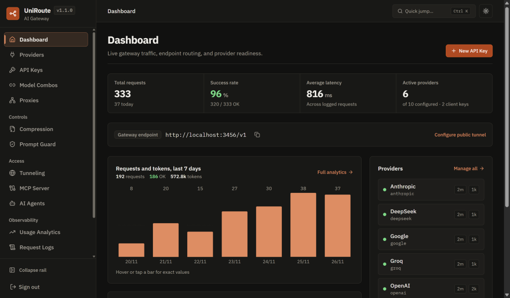
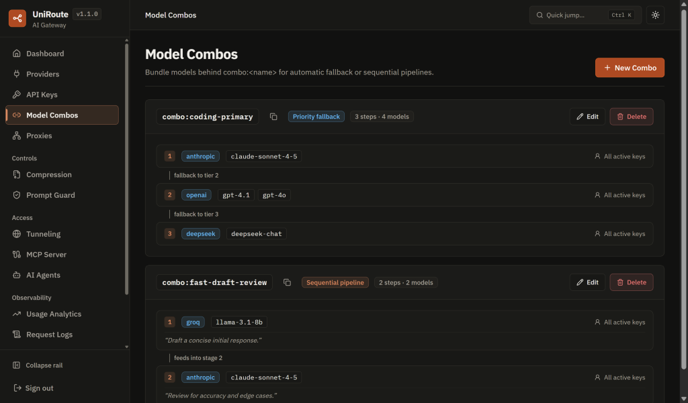
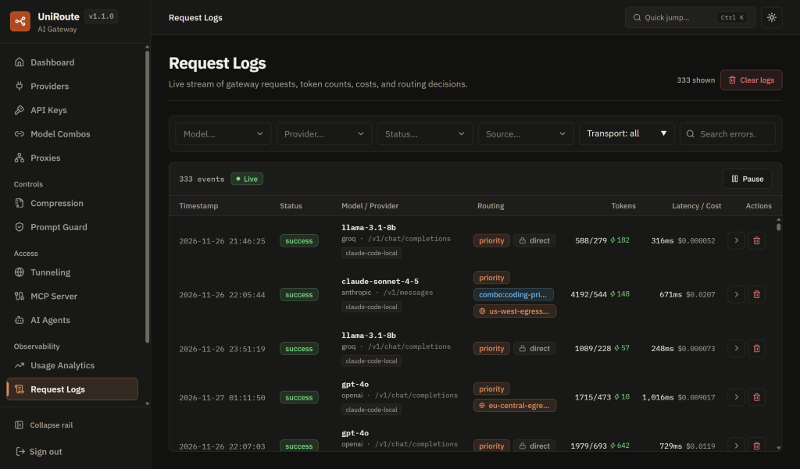

<div align="center">

# UniRoute

Self-hosted AI gateway and web dashboard. Route OpenAI, Anthropic, and Gemini traffic through one endpoint with fallback combos, client keys, outbound proxies, and MCP control.

[](https://github.com/mygcp/uniroute/releases)
[](docs/getting-started.md)

[Quick Start](#quick-start) · [Features](#features) · [Documentation](#documentation)

<br />

<picture>
  <source media="(prefers-color-scheme: dark)" srcset="docs/images/dashboard-dark.png" />
  <source media="(prefers-color-scheme: light)" srcset="docs/images/dashboard-light.png" />
  
</picture>

</div>

## Features

- Unified `/v1/*` API with automatic translation across OpenAI, Anthropic, and Gemini formats (chat, responses, images, and audio).
- Model combos (`combo:<name>`) for priority fallback chains and sequential multi-model pipelines.
- Client API keys with quotas, monthly budgets, IP rules, expiry, and key rotation.
- Outbound HTTP CONNECT and SOCKS5 proxy pools with health tracking and per-key or per-provider routing.
- Prompt Guard filtering, optional prompt compression (RTK and Caveman Engine), and built-in public tunnels (`cloudflared`, `ngrok`, `frpc`, `bore`).
- Live request logs, token and cost analytics, and a per-provider chat playground stored in SQLite.
- Built-in MCP server with 55 tools (stdio and remote HTTP) plus one-click config for Claude Code, Codex CLI, and OpenCode.

<table>
  <tr>
    <td width="50%">
      
      <p align="center"><sub><strong>Model Combos:</strong> priority fallback chains and sequential pipelines</sub></p>
    </td>
    <td width="50%">
      
      <p align="center"><sub><strong>Request Logs:</strong> live traffic, egress proxies, cached tokens, and cost</sub></p>
    </td>
  </tr>
</table>

## Quick Start

**macOS / Linux:**

```bash
curl -fsSL https://raw.githubusercontent.com/mygcp/uniroute/main/install.sh | sh
uni start --daemon
```

**Windows (PowerShell):**

```powershell
irm https://raw.githubusercontent.com/mygcp/uniroute/main/install.ps1 | iex
uni start --daemon
```

**From source ([Bun](https://bun.sh)):**

```bash
bun install && bun run dev
```

Open `http://localhost:3000` (or `http://localhost:5173` in dev mode) and sign in with the default password `CHANGEME`. Copy `.env.example` to `.env` to customize port, password, or database path.

For Termux/Android, standalone binaries, self-updates, and CLI flags, see [Getting Started](docs/getting-started.md).

## Documentation

| Guide | Topics |
| --- | --- |
| [Getting Started](docs/getting-started.md) | Installation, Termux, first provider, first request |
| [Configuration](docs/configuration.md) | Environment variables and `.env` options |
| [Architecture](docs/architecture.md) | Request lifecycle, stack, and SQLite schema |
| [Providers](docs/providers.md) | Upstream providers, credentials, models, vision and audio |
| [Model Combos](docs/combos.md) | Priority fallback and sequential pipelines |
| [Proxy Engine](docs/proxy-engine.md) | Outbound proxies, pools, rotation strategies, egress rules |
| [Compression](docs/compression.md) | Global prompt compression with RTK and Caveman Engine |
| [Tunneling](docs/tunneling.md) | Public tunnels, auto-start, and custom domains |
| [Monitoring](docs/monitoring.md) | Realtime request logs, proxy logs, usage analytics |
| [Chat Playground](docs/chat-playground.md) | Multi-turn chat and saved sessions |
| [AI Agents & MCP](docs/ai-agents.md) | Coding agent setup, remote HTTP MCP, full tool list |
| [API Reference](docs/api-reference.md) | `/v1/*` endpoints and error formats |
| [Performance](docs/performance.md) | Measured baseline and benchmarks |
| [Development](docs/development.md) | Scripts, testing, and code conventions |
